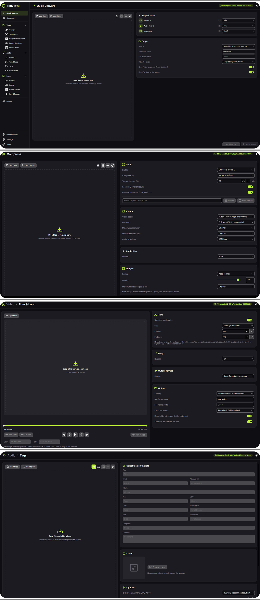

# CONVERTit

CONVERTit brings video, audio and image conversion together in one clear interface. Drop files or folders on the window – or right-click them in Explorer – pick a target format or a size, and add them to the queue. Video, audio and image tools each have their own area in the sidebar, so every task has exactly the options it needs.

## Highlights

- **Quick Convert** — Drop anything: videos, audio files and images are recognized and converted in one go.
- **Compress** — Make videos, audio files and images smaller: by **target size** (e.g. 25 MB for e-mail, 10 MB for chats – two-pass encoding hits the size closely), by **share of the original** (e.g. 50 %) or by **quality level**. Ready-made profiles plus your **own profiles**; results that would not be smaller are discarded.
- **Select files** — Ctrl/Shift + click or Ctrl+A in every file list; *Add selected* queues only those files with the current settings, the rest can get other settings.
- **Folder batches** — Add a whole folder, e.g. *all audio files* (MP3, OGG, M4A, FLAC, WAV …) or only the extensions you list, with subfolders and mirrored folder structure.
- **Video with full control** — MP4, MKV, WebM, MOV, AVI · H.264, H.265, AV1, VP9 · quality levels from *Best* to *Very small*, constant quality (CRF), fixed bitrate or a **file size slider** (share of the original) · resolution presets from 360p to 4K or your own size · aspect ratios 16:9, 4:3, 1:1, 9:16, 21:9, 4:5 or your own · frame rate 23.976 – 120 fps or your own.
- **Audio in every common quality** — MP3 320/256/192/128 kbps or VBR V0–V9, AAC, Opus, Ogg Vorbis, FLAC, ALAC, WAV · sample rate, mono/stereo, tags and cover · **loudness normalization** (EBU R128) and **silence trimming**.
- **Tag editor** — Like Mp3tag: title, artist, album, album artist, year, track, disc, genre, composer, comment and cover for **MP3 (ID3v2.3/v2.4, ID3v1), FLAC, OGG, Opus, M4A, WAV and AIFF** – many files at once, tags from file names, file names from tags, track numbering.
- **Mini player** — Play/pause and a seek bar in every row of the audio lists (Tags, Audio › Convert, Game audio), switchable per list.
- **Game development** — **Game textures** for Unity, Unreal Engine, Godot and DirectX engines: **TGA** (RLE), **DDS** (BC1/DXT1, BC3/DXT5, mipmaps), PNG, power-of-two sizes. **Game audio** presets for Unity, Unreal Engine and Godot – sound effects (WAV, mono, silence trimmed) and music (OGG Vorbis or WAV, −16 LUFS).
- **Images and icons** — PNG (compression, 256-color palette, transparency), JPEG, WebP, AVIF, TIFF, BMP, GIF, TGA, DDS · resize · EXIF rotation and metadata removal · multi-size ICO and a complete favicon package.
- **Trim & Loop with player** — Built-in VLC player with timeline: start and end by click or key (I/O), exact or fast cut, fades, loops, boomerang.
- **GIF and animated WebP**, **Remux** (new container without re-encoding) and **audio extraction**.
- **Explorer context menu** — Right-click media files: *Open in CONVERTit*, *Convert to MP4 / MP3 / OGG / PNG / JPG / WebP*, *Compress …*, *Extract audio* – separate menus for videos, audio files and images, several files at once.
- **Hardware encoders** — NVIDIA NVENC, Intel Quick Sync and AMD AMF, tested on your PC before they can be chosen.
- **Always see what's happening** — A progress bar in the header shows when files are loaded, large videos are opened or FFmpeg is downloaded.
- **Queue** — Colored status (waiting, running, done, failed), progress, size before/after and savings for every job, console with the FFmpeg command, retry and cancel.
- **Windows integration** — Progress in the taskbar, Windows notification with *Open folder* when a batch is done, no standby during long batches, *below normal* priority.
- **Fits every screen** — Display profiles from *extra small* (tablets under 10″) to *extra large* (monitors from 30″), or *Auto*.
- **Modern interface** — Dark mode (default), light mode or *System*, neon-green accent, smooth animations, English and German (chosen automatically on the first start).

## Navigation

| Area | What you'll find |
| --- | --- |
| **Quick Convert** | Drop zone for everything; one target format each for videos, audio files and images. |
| **Compress** | Target size, share of the original or quality · profiles · settings for videos, audio files and images. |
| **Video** | Convert · Trim & Loop · GIF / Animated WebP · Remux · Extract audio |
| **Audio** | Convert · Trim & Loop · Tags · Game audio |
| **Image** | Convert · Resize · Game textures · Icon & Favicon |
| **Queue** | All jobs with status, progress, result and console. |
| **Dependencies** | FFmpeg install/update/own folder, hardware encoder test, bundled components. |
| **Settings** | Language, appearance (theme, display profile, sidebar, start maximized), FFmpeg module, performance, Windows integration (notifications, context menu), data folder. |
| **About** | Version, license, components. |

## Requirements

- Windows 10 (1809 or newer) or Windows 11, 64-bit.
- The .NET runtime, ImageMagick and VLC are included.
- **FFmpeg** is the engine behind all video and audio conversions. It is **not included** in CONVERTit and is installed once – CONVERTit does this for you (see below). Images work without FFmpeg.

## How To – Step by Step

**1 · Install**

1. Download `convertit_vX.Y.Z_setup.exe` or `convertit_vX.Y.Z_portable.zip` from the [releases](https://github.com/complicatiion/CONVERTit/releases).
2. **Setup:** run it – it installs for your user without administrator rights. **Portable:** extract the ZIP and start **`CONVERTit.exe`**.
3. On the first start CONVERTit uses German on German systems and English everywhere else – you can change it under **Settings → Language**.

**2 · Install FFmpeg (once)**

1. On the first start a dialog explains what FFmpeg is and asks whether it should be installed. Click **Download & install**.
2. CONVERTit downloads the current Windows build from the official [BtbN/FFmpeg-Builds](https://github.com/BtbN/FFmpeg-Builds/releases) releases on GitHub, checks its checksum and stores it in the CONVERTit data folder. The header then shows **✓ FFmpeg x.y**.
3. Clicked *Later*? Click the orange **FFmpeg missing** in the header, or go to **Dependencies** / **Settings → Modules**.
4. FFmpeg already installed somewhere else? Use **Choose FFmpeg folder** and select the folder that contains `ffmpeg.exe` and `ffprobe.exe`.

**3 · Compress a video for e-mail or chat**

1. Go to **Compress** and drop the video.
2. Choose a **profile**, e.g. *E-mail · 25 MB* – or set **Target size** yourself.
3. Click **Add to queue**. The result lands in a `compressed` folder next to the original.
4. Your own settings can be saved as a profile (name → **Save profile**).

**4 · Convert a whole folder (example: all audio files to MP3 320 kbps)**

1. **Audio → Convert**, open the folder options (⚙): *Include subfolders*, *All files of this type*.
2. **Add folder** or drop it on the window.
3. **Format** *MP3*, **Bitrate** *320 kbps* → **Add to queue**.

**5 · Textures and sounds for Unity or Godot**

1. **Image → Game textures**: choose the **engine preset** (Unity/Unreal → TGA, Godot → PNG, DirectX/mods → DDS with mipmaps) and, if needed, a maximum texture size.
2. **Audio → Game audio**: *sound effects* (WAV, mono, silence trimmed) or *music* (OGG, normalized to −16 LUFS).

**6 · Edit tags (MP3, FLAC, OGG, M4A …)**

1. **Audio → Tags**, add files or a folder; select one or several files (Ctrl/Shift, Ctrl+A).
2. Change the fields – with several files, *‹keep›* means the files keep their own value. Add a cover with **Choose cover** or by dropping an image on the window.
3. **Save tags**. Tools: *Tags from file names*, *Rename files from tags* (pattern e.g. `%track% - %artist% - %title%`), *Number tracks*, *Title Case*.
4. MP3 files get ID3v2.3 by default (best compatibility with Windows and car radios); ID3v2.4 and an extra ID3v1 tag can be chosen.

**7 · Right-click in Explorer**

1. **Settings → Windows integration → Explorer context menu** on.
2. Right-click media files → **CONVERTit** → e.g. *Convert to MP4* or *Compress …*. On Windows 11 the entry is under **Show more options**.

### Supported formats

| Type | Read | Write |
| --- | --- | --- |
| Video | MP4, M4V, MKV, WebM, MOV, AVI, WMV, FLV, MPEG, TS/M2TS, 3GP, OGV, VOB, MXF … | MP4, MKV, WebM, MOV, AVI · GIF, animated WebP |
| Audio | MP3, AAC/M4A, Opus, OGG, FLAC, WAV, WMA, AIFF, APE, WavPack, AC3, DTS, MKA … | MP3, AAC (M4A), Opus, Ogg Vorbis, FLAC, ALAC, WAV |
| Image | PNG, JPEG, WebP, AVIF, HEIC, TIFF, BMP, GIF, ICO, PSD, TGA, DDS, SVG, JXL … | PNG, JPEG, WebP, AVIF, TIFF, BMP, GIF, ICO, TGA, DDS |

More: [docs/FORMATS.md](docs/FORMATS.md) · [docs/FEATURES.md](docs/FEATURES.md) · Changes: [docs/CHANGELOG.md](docs/CHANGELOG.md)

## Privacy & Security

- Everything runs locally. CONVERTit sends no data anywhere and has no telemetry.
- Only when you install or update FFmpeg, CONVERTit contacts `api.github.com`/`github.com` – nothing is sent except the request itself.
- Source files are only read; results are always new files.
- Settings are stored in `%LocalAppData%\CONVERTit` (portable: `data` next to the app). Details: [licenses/PRIVACY.md](licenses/PRIVACY.md).

## Credits

CONVERTit is built on **[FFmpeg](https://ffmpeg.org/)** (used as a separate program), **[ImageMagick](https://imagemagick.org/)** via **[Magick.NET](https://github.com/dlemstra/Magick.NET)** and **[LibVLC](https://www.videolan.org/vlc/libvlc.html)** via **[LibVLCSharp](https://code.videolan.org/videolan/LibVLCSharp)** and **[TagLib#](https://github.com/mono/taglib-sharp)**. The interface is made with **[Avalonia UI](https://avaloniaui.net/)** and **[CommunityToolkit.Mvvm](https://github.com/CommunityToolkit/dotnet)** on **[.NET](https://dotnet.microsoft.com/)**. Windows FFmpeg builds by **[BtbN](https://github.com/BtbN/FFmpeg-Builds)**. Icons: **[Material Design Icons](https://pictogrammers.com/library/mdi/)**, font: **[Inter](https://rsms.me/inter/)**. Licenses: [licenses/README.md](licenses/README.md).

## Project & Copyright

CONVERTit is a personal software project by **Sven Klocke** (*sksdesign | complicatiion*).

**Project repository:** [github.com/complicatiion/CONVERTit](https://github.com/complicatiion/CONVERTit)  
**Website:** [sksdesign.de](https://sksdesign.de)

CONVERTit is released under the **MIT License** ([licenses/LICENSE.md](licenses/LICENSE.md)).

## Disclaimer & Notes

- **FFmpeg** is a separate program and is not part of CONVERTit. CONVERTit only calls it via the command line; the downloaded Windows build (GPL variant, includes x264/x265) is licensed under the **GPL**, CONVERTit itself stays MIT-licensed. You install it yourself by confirming the download. Source code and license of FFmpeg: [ffmpeg.org/legal](https://ffmpeg.org/legal.html), [licenses/third-party/FFMPEG.md](licenses/third-party/FFMPEG.md).
- **Codecs & patents:** some codecs (e.g. H.264, H.265) may be covered by patents in some countries. Whether you need a license depends on your use and country – see [licenses/LEGAL-NOTICE.md](licenses/LEGAL-NOTICE.md).
- **Hardware encoders:** an encoder listed by FFmpeg does not mean that the matching GPU and driver are present. CONVERTit therefore tests every hardware encoder with a short test encode; only encoders that work can be chosen. They are fast but produce larger files than software encoders at the same quality.
- **Performance:** video encoders already use all CPU cores – one parallel video job is usually fastest. *Below normal* priority keeps the PC responsive while converting.
- **Tag editor:** tags are written directly into the files (not into copies); a backup copy protects each file until the write succeeded. The audio data is not changed.
- **Output:** results are written to a temporary file first and renamed when complete, so an aborted job never leaves a half-written file. Originals are never changed.
- **Compress:** a target size is a goal, not a guarantee – very short or very complex videos can end up a little larger or smaller. Images do not use the target size; quality and maximum size decide.
- **Quality:** converting to a lossy format (MP3, AAC, H.264 …) always loses some quality; converting a lossy file to FLAC or WAV does not restore it. A *fast cut* starts at the previous keyframe (up to a few seconds earlier).
- **Windows notifications and the Explorer menu** need a small registration for your user (no administrator rights). It can be removed under *Settings → Windows integration*; the uninstaller removes it automatically.
- Only convert files you are allowed to use. Copy-protected media (DRM) is not supported.
- CONVERTit is provided **without warranty**; liability is limited to the extent permitted by law – see [licenses/LEGAL-NOTICE.md](licenses/LEGAL-NOTICE.md) and [licenses/COPYRIGHT.md](licenses/COPYRIGHT.md).
- Windows, FFmpeg, VLC, ImageMagick, Unity, Godot, DirectX, NVIDIA, Intel and AMD are trademarks of their respective owners. CONVERTit is not affiliated with or endorsed by them.
